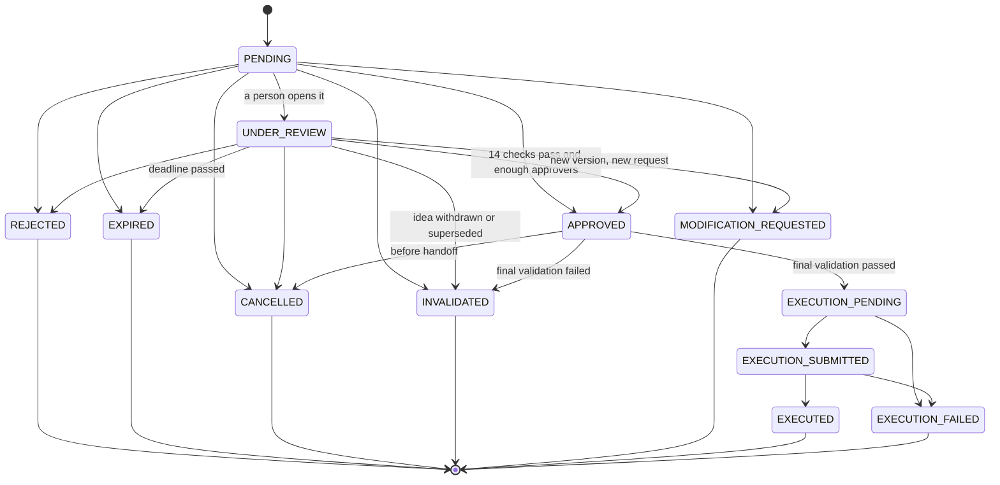
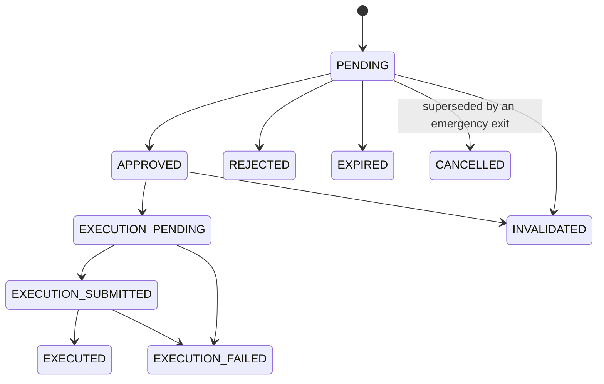

# Approval state machine

The source of truth is `aurum/approvals/states.py`. Every status change goes through `ApprovalService._move`, which
checks the transition, bumps `version` with a conditional update, writes the audit row and emits the event. PostgreSQL
enforces the same transitions with the trigger `trg_approval_transition` on `approval_requests`, which also requires
`version` to increase by exactly one on every status change.

| Status | Meaning | Who moves it |
|---|---|---|
| `PENDING` | Created, waiting for a person | intake |
| `UNDER_REVIEW` | A person with decide permission opened it | `POST /{id}/review` (the UI calls it on open) |
| `APPROVED` | Final human approval recorded | `POST /{id}/approve` |
| `REJECTED` | Rejected with a reason code | `POST /{id}/reject` |
| `MODIFICATION_REQUESTED` | Changes asked for. Parameter changes open a new request for a new idea version | `POST /{id}/request-modification` |
| `EXPIRED` | Not decided before `expires_at` | worker, or the approve call itself |
| `CANCELLED` | Cancelled by a person, or the source withdrew the idea | `POST /{id}/cancel`, Module 05 sync |
| `INVALIDATED` | No longer valid (superseded, or final validation failed) | service, worker |
| `EXECUTION_PENDING` | Handed to Module 09 | handoff |
| `EXECUTION_SUBMITTED`, `EXECUTED`, `EXECUTION_FAILED` | Module 09 reports | `POST /execution/results` |

## Guarantees (tested in `tests/approvals/test_state_machine.py`)
- Nothing returns to `PENDING`, and `APPROVED` never returns to `PENDING` or `UNDER_REVIEW`.
- `REJECTED`, `EXPIRED`, `CANCELLED`, `INVALIDATED` and `MODIFICATION_REQUESTED` are terminal. They can never become
  `APPROVED` or be executed.
- Only `PENDING` and `UNDER_REVIEW` can expire, so expiry never undoes an approval.
- Only `APPROVED` can be handed to execution.
- An unknown status is never a legal move (`IllegalTransition`).
- Opening a request only moves it to `UNDER_REVIEW`. Nothing approves automatically.

## The 14 approval checks
If any check fails, `approve` responds `409 APPROVAL_CHECKS_FAILED` and lists **every** failed check in `error.details`.
The refusal is audited as `approve.refused`.

1. The caller is a signed-in person with `approvals:decide`. A service token never qualifies (`403`).
2. The request is `PENDING` or `UNDER_REVIEW` (`409 NOT_PENDING`).
3. The request has not expired. If it has, it is moved to `EXPIRED` and refused (`409 EXPIRED`).
4. `requestVersion` equals the current version (`409 STALE_VERSION`), for example after a risk revalidation.
5. The trade idea is still valid at its source (not cancelled or expired).
6. The idea has no newer version.
7. An evidence snapshot exists, policy-required sections are not missing, and `evidenceHash` equals the snapshot the
   person viewed.
8. The Module 06 decision is not `BLOCK` or `ERROR`. These can never be approved, by anyone, under any policy.
9. For a `REVIEW` decision, policy allows approving it and every warning's `ruleId` is in `acknowledgedWarnings`.
10. The Module 06 assessment is still valid (`validate`) and younger than `review.risk_max_age_seconds`. The latest quote
    is younger than `review.market_data_max_age_seconds`.
11. The `confirmation` matches the current symbol, direction, entry, stop-loss, take-profit, position size and maximum
    risk exactly. Numbers are compared as decimals.
12. The person has not already decided on this request (`409 ALREADY_DECIDED`). With multi-person policy, the request
    becomes `APPROVED` only when `approvalsRequired` different people have approved it.
13. The person may act on the trading account, and policy allows the account (`handoff.allowed_accounts`).
14. No Module 06 lock is active, and the locks can be read.

Policy extras: `review.require_comment_on_approve`, and `review.reviewers_see_assigned_only` (reviewers act only on
requests assigned to them).

## Expiry
`Policy.expiry_window()` takes the shortest of the timeframe default (M5 5, M15 15, H1 60, H4 240, D1 1440 minutes), the
symbol override, the strategy override and the high-volatility override. The result is clamped to
`[min_minutes, max_minutes]`. If the idea has its own earlier expiry, that wins. The worker expires due requests and
sends an "expiring soon" notification `expiring_soon_minutes` before the deadline.

## Rejection and modification
- **Reject** needs a `reasonCode` from `review.rejection_reasons`. `other` also needs a comment. The rejection is written
  back to Module 05 (`module05.feedback`).
- **Request modification** takes `kinds`, for example `change_entry` or `request_additional_analysis`. Parameter
  changes (`changes.entry`, `stopLoss`, `takeProfit`, `positionSize`) create a new idea version with a fresh Module 06
  assessment and evidence, and a new request linked by `parentApprovalId`. The original request stays as it was.

## Management requests

See [TRADE_MANAGEMENT_GUIDE.md](TRADE_MANAGEMENT_GUIDE.md).
