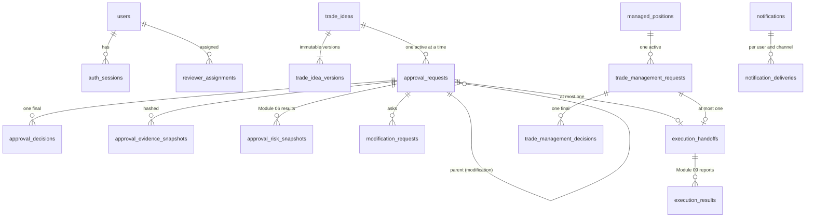

# Module 07 database schema

Migration: `sql/migrations/0009_human_approval.sql`, applied by `python -m aurum.cli init-db`. It is idempotent
(`CREATE … IF NOT EXISTS`, `CREATE OR REPLACE FUNCTION`, triggers dropped and re-created) and was verified twice on the
`aurum-timescaledb` PostgreSQL 16 container. SQLAlchemy models: `aurum/approvals/db_models.py` and
`aurum/auth/db_models.py`. `tests/approvals/test_migration.py` checks that the SQL and the models declare the same
tables and columns.

The 19 specification tables plus 3 authentication tables: 22 in total. Prices and volumes are `NUMERIC`, never floats.
Timestamps are `TIMESTAMPTZ` (UTC).

## Entity relationships

## Tables
| Table | Purpose | Key constraints |
|---|---|---|
| `users` | People and their role | `username` unique. Password hash only (PBKDF2-SHA256) |
| `auth_sessions` | Sign-in sessions | FK `users`. `token_hash` unique (the token itself is never stored). CSRF hash, idle and absolute expiry |
| `service_tokens` | Tokens for n8n and other modules | `token_hash` unique, scopes, expiry, revocation |
| `trade_ideas` | One row per idea (Module 05, event or manual) | Source plus source reference deduplicated. `current_version` |
| `trade_idea_versions` | Immutable parameters of each version | FK `trade_ideas`, unique (`idea_id`, `version`). **Append-only** |
| `approval_requests` | The request a person decides on | FK idea, parent request, assignee, requester. `idempotency_key` unique. Optimistic `version`. **Transition trigger** |
| `approval_decisions` | Each person's decision, with the exact confirmation and hashes | FK request and user. Unique (`approval_id`, `user_id`). **One final per request** (partial unique). **Append-only** |
| `approval_evidence_snapshots` | Evidence content and its SHA-256 `content_hash` | **Append-only** |
| `approval_risk_snapshots` | Every Module 06 result used (initial, revalidation, handoff) | **Append-only** |
| `modification_requests` | Requested changes and the new request they opened | FK request and user |
| `execution_handoffs` | Execution requests for Module 09 (trade or management) | `approval_id` unique, `management_request_id` unique, `idempotency_key` unique, payload hash |
| `execution_results` | Module 09 reports | FK handoff. `event_id` unique. **Append-only** |
| `managed_positions` | Open positions (account mirror or Module 09) | Position id, source, freshness |
| `trade_management_requests` | Requested position changes | `idempotency_key` unique. **One active per position** (partial unique) |
| `trade_management_decisions` | Decisions on management requests | **One final per request** (partial unique). **Append-only** |
| `notifications` | In-app notifications | `dedupe_key` unique |
| `notification_deliveries` | Per user, channel and status (pending / sent / failed / dead / not_configured) | Unique (notification, user, channel) |
| `reviewer_assignments` | Routes requests by symbol, strategy or timeframe to reviewers | FK `users` |
| `approval_policies` | Versioned policy documents with reason and author | **Append-only** (a change adds a version) |
| `approval_audit_logs` | Every action, hash-chained (`prev_hash`, `hash`) | **Append-only**. `GET /approvals/health` verifies the chain |
| `idempotency_records` | Stored responses for retried requests and events | Unique (`scope`, `key`) |
| `outbox_events` | Transactional outbox | `event_id` unique, `idempotency_key` unique, delivery status, attempts, `next_attempt_at` |

## Indexes
- **Queues.** `ix_approval_requests_status_expires (status, expires_at)`, `ix_outbox_events_due (status, next_attempt_at)`,
  `ix_notification_deliveries_due (status, next_attempt_at)`.
- **Lookups.** By `idea_id`, `symbol`, `approval_id`, `request_id`, `position_id`, `user_id`, `event_type` and
  `created_at` (see the migration for the full list).
- **Partial unique (safety):**
  - `uq_approval_requests_active_idea ON approval_requests(idea_id) WHERE status IN (active states)`: one live request
    per idea.
  - `uq_approval_decisions_final ON approval_decisions(approval_id) WHERE is_final`: one final decision.
  - `uq_trade_management_active_position ON trade_management_requests(position_id) WHERE status IN (active states)`.
  - `uq_trade_management_decisions_final ON trade_management_decisions(request_id) WHERE is_final`.

## Triggers (PostgreSQL)
- `trg_approval_transition` (BEFORE UPDATE on `approval_requests`) rejects any status change that is not in
  `APPROVAL_TRANSITIONS`, and any status change without `version = old.version + 1`. The allowed pairs are generated from
  `states.transition_sql_pairs()`, so code and database cannot drift apart. `test_migration.py` checks this.
- `trg_<table>_append_only` (BEFORE UPDATE OR DELETE) on `approval_audit_logs`, `approval_decisions`,
  `trade_idea_versions`, `approval_evidence_snapshots`, `approval_risk_snapshots`, `execution_results`,
  `trade_management_decisions` and `approval_policies` raises an error, so history cannot be rewritten.

SQLite (used by tests and the quick-start) has no triggers. The same rules are enforced in the service, and the tests
cover them there.

## Retention
Nothing in Module 07 deletes rows. Audit, decisions and results are permanent by design. Outbox rows remain with their
delivery status.
