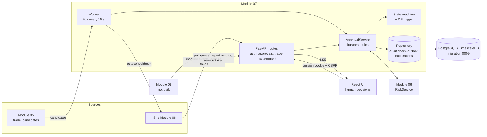
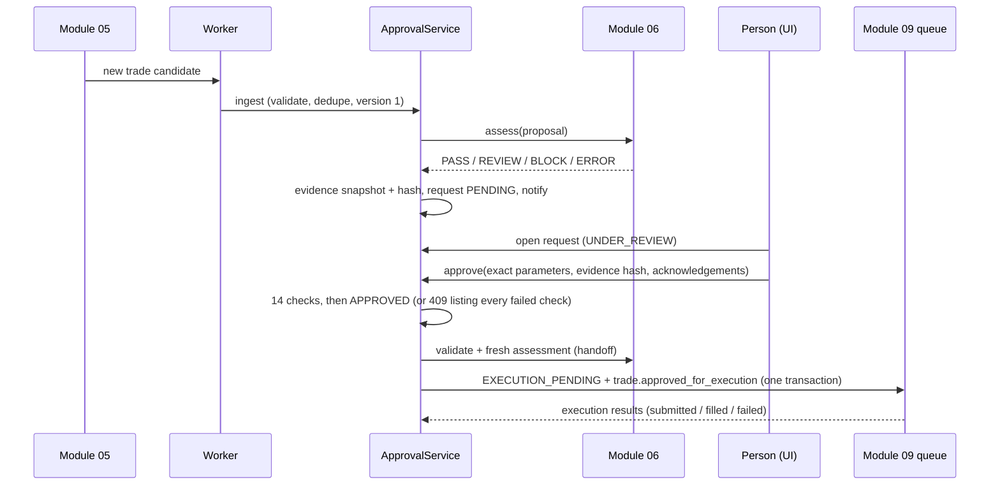
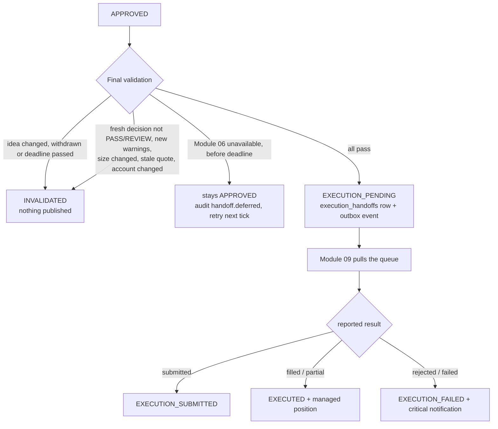
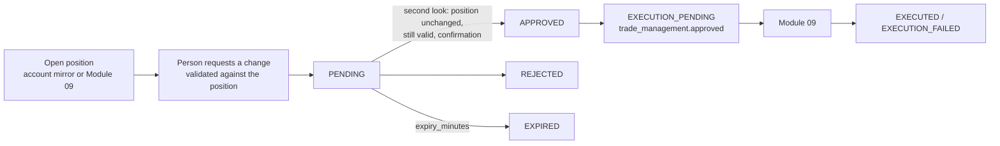
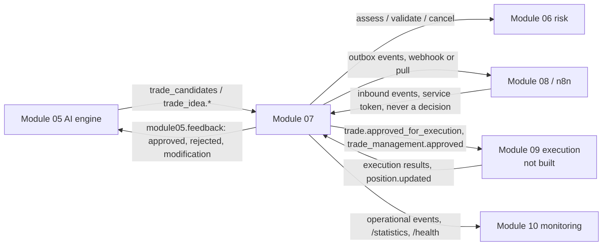
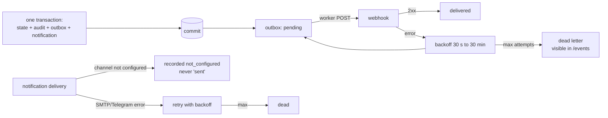

# Module 07 architecture

## Components
| Layer | Code | Responsibility |
|---|---|---|
| Authentication | `aurum/auth/` (`service.py`, `passwords.py`, `roles.py`, `db_models.py`), `aurum/api/security.py`, `aurum/api/routes/auth.py` | Users (PBKDF2-SHA256), sessions (httpOnly cookie + CSRF), service tokens, roles and permissions, lockout |
| Intake | `aurum/approvals/intake.py` | Validates an idea payload: prices as `Decimal`, SL/TP on the right side, timeframe, expiry. Normalises Module 05 rows |
| Evidence | `aurum/approvals/evidence.py` | Builds the six evidence sections from Modules 03–06 and hashes the snapshot |
| Gateways | `aurum/approvals/gateways.py` | `RiskGateway` / `InProcessRiskGateway` (Module 06), `IdeaSource` (Module 05), quote time, locks |
| Policy | `aurum/approvals/policy.py`, `config/approvals.yaml` | Validated, versioned policy: expiry, review rules, handoff, management, notifications |
| State machine | `aurum/approvals/states.py` + PostgreSQL trigger | Allowed transitions for approvals and management requests |
| Repository | `aurum/approvals/repository.py` | Serialised writes (process lock + `pg_advisory_xact_lock`), audit hash chain, outbox, notifications, idempotency |
| Service | `aurum/approvals/service.py` | All business rules: intake, review, approve/reject/modify/cancel, expiry, handoff, Module 09 results, positions, management, inbound events, views |
| Worker | `aurum/approvals/worker.py` | Periodic tick: Module 05 sync, expiry, handoff, Module 05 feedback, outbox dispatch, email/Telegram delivery |
| Wiring | `aurum/approvals/wiring.py` | `build_service(engine, settings)` with lazy Module 04, 05 and 06 services |
| API | `aurum/api/routes/approvals.py`, `aurum/api/routes/system.py` (notifications merge) | `/api/v1/approvals/*`, `/api/v1/trade-management/*`, SSE stream |
| CLI | `aurum/approvals/cli.py` | `users …` and `approvals …` commands |
| Frontend | `aurum-frontend/src/pages/{LoginPage,ApprovalsPage,ApprovalDetailPage,TradeManagementPage,NotificationsPage}.tsx`, `src/components/approvals/*`, `src/hooks/useApprovals.ts`, `src/hooks/useSession.ts` | Sign-in, Command Centre, review with final confirmation, position management, notifications |

## Architecture

## Approval lifecycle

After a final approval, the handoff is attempted immediately. If that attempt fails (for example, Module 06 is briefly
unavailable), the approval stands and the worker retries it on every tick until the handoff deadline.

## Trade execution handoff

## Trade management lifecycle

## Module integration

## Failure handling

- **Concurrency.** Every status change is a conditional `UPDATE … WHERE version = :v AND status = :s`. A lost race returns
  `409 CONCURRENT_CHANGE`. Writes are serialised with a process lock and a PostgreSQL advisory lock. Partial unique
  indexes allow only one active request per idea, one final decision per request and one active management request per
  position.
- **Idempotency.** Decisions carry `clientRequestId`, inbound events and execution results carry `eventId`, and outbox
  rows carry a unique `idempotency_key`. A retry returns the original result instead of acting twice.
- **Worker isolation.** Each step of a tick is independent. A failing step is logged and the others still run.
- **Module 06 unavailable.** At approval, the approval is refused with the reason. At handoff, it is deferred until the
  deadline and then invalidated. It is never handed off unchecked.

## Key decisions
1. **Same database, no new services.** The outbox table, with pull and webhook delivery, replaces a message bus. The
   worker is a CLI loop and can also run as a container.
2. **The service is the only authority.** n8n, Telegram and email can only notify. Every decision endpoint requires a
   signed-in person, and `HUMAN_ONLY` permissions are stripped from service tokens.
3. **Decimal everywhere.** Prices and volumes are `Decimal` in Python and `NUMERIC` in SQL. Confirmations are compared
   as decimals.
4. **No silent changes.** A modification creates a new idea version and a new request with a fresh risk assessment. The
   original request is kept as it was.
5. **No duplicated logic.** Risk numbers always come from Module 06, and analysis always comes from Modules 03–05.
