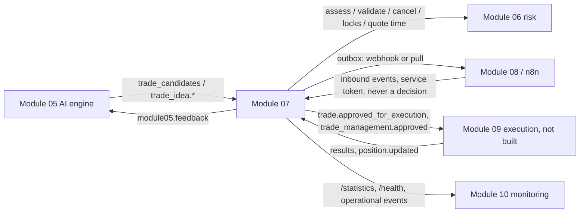

# Module 07 integration guide

Each integration below is labelled **REAL** (working against the actual module), **CONTRACT ONLY** (implemented and
tested with a labelled test adapter because the other side does not exist yet), or **OPTIONAL** (needs configuration).

## Module 05: AI decision engine (REAL)
- **In.**
  - `ApprovalService.sync_module05()` runs on every worker tick and from `POST /approvals/sync`. It reads Module 05's
    `trade_candidates` through `DecisionService` (`IdeaSource`).
  - It converts float prices to `Decimal` (the original values stay in the stored payload), validates them and ingests.
  - Candidates that Module 05 later rejects or expires close their open request (`CANCELLED` or `INVALIDATED`).
- **In (events).** `trade_idea.created`, `trade_idea.updated` and `trade_idea.cancelled` on `/approvals/events/inbound`.
- **Out.**
  - Each decision becomes a `module05.feedback` outbox event, which the worker applies through Module 05's own
    `DecisionService` (approved, rejected with reason, modification requested).
  - If Module 05 refuses (for example its gate now fails), the refusal is recorded and **never** changes the Module 07
    decision.
- **Not duplicated.** Module 07 does no analysis. It shows Module 05's evidence and AI summary, labelled
  `ai_interpretation`.

## Module 06: risk management (REAL)
- `InProcessRiskGateway` wraps Module 06's `RiskService` and is used for:
  - `assess` at intake, revalidation and handoff;
  - `validate` at approval and handoff;
  - `cancel` (an old assessment is cancelled before a new one, so locks and exposure are not double-counted);
  - `locks`, `quote_time` and `account_login`.
- `tests/approvals/test_integration_module06.py` runs the real `RiskService` (with its in-memory data store) through
  intake → approve → handoff, including a BLOCK.
- **Not duplicated.** Module 07 never computes position size or risk. It displays and compares Module 06's numbers.
- **Unavailable.** Approval is refused with the reason. Handoff is deferred until its deadline, then invalidated.

## Module 08 / n8n (REAL transport, OPTIONAL setup)
- **Outbound.** Set `APPROVALS_EVENTS_WEBHOOK_URL=http://localhost:5678/webhook/aurum-approval-events`. The worker POSTs
  each event (snake_case envelope) with retries and a dead-letter state. Without a URL, n8n can poll
  `GET /api/v1/approvals/events?after=<n>` with a service token.
- **Workflows** (`n8n/workflows/`, imported inactive):
  - `aurum_approval_events_receiver.json`: receives events. For `approval.requested`, `approval.invalidated`,
    `execution.failed` and `trade_management.requested` it builds a message with a link to the AURUM UI, then a
    placeholder notify node (connect Telegram, Slack or email). It has no approve action.
  - `aurum_approval_expiry_reminder.json`: every 2 minutes it calls `GET /approvals/pending` with a service token and
    flags requests expiring within 5 minutes. It is read-only.
- **Set up the credential.**
  1. Run `python -m aurum.cli users token-create n8n --scope approvals:view --scope events:publish`.
  2. In n8n, create a Header Auth credential: name `Authorization`, value `Bearer <token>`.
  3. Select it on the HTTP node. The token is never written into the workflow file
     (`tests/approvals/test_n8n_workflows.py` checks this).
- **Inbound.** n8n may post `trade_idea.*` or `position.updated` events. It **cannot** approve, reject or manage: those
  endpoints need a signed-in person, and service tokens never get human-only permissions.

## Module 09: MT5 execution (CONTRACT ONLY, Module 09 not built)
- **Out.**
  - `trade.approved_for_execution` and `trade_management.approved` go to the outbox.
  - The same payloads are in `GET /api/v1/approvals/execution/queue` (service token, `execution:read`), which marks
    them picked up and carries a `payload_hash`.
- **In.** `POST /api/v1/approvals/execution/results` (`execution:report`) and `position.updated` events.
- **Tested with** `FakeExecution` in `tests/approvals/m07_harness.py`: submitted, filled and failed reports, plus
  duplicate and out-of-order reports, and management results.
- **What Module 09 must do:**
  - Re-validate with Module 06 immediately before any order.
  - Never exceed `approved_volume`, and always send the stop-loss.
  - Report every outcome with a unique `eventId`.
  - Deduplicate on `idempotency_key` (`exec:<approval id>`).
- **Until then,** approved requests stay `EXECUTION_PENDING`, the UI says so, and nothing is executed.

## Module 10: monitoring (CONTRACT ONLY)
- `GET /approvals/health`: schema readiness, audit-chain verification, the dependency status of Modules 05, 06 and 09,
  outbox pending and dead counts, and notification failures. `approvals status` on the CLI shows the same.
- `GET /approvals/statistics?since=`: counts, approval and rejection rates, time to decision.
- All outbox events are available for monitoring through pull or SSE. Module 10 does not exist yet, so nothing consumes
  these today.

## Frontend
- **Sign-in** (`/login`): a server account when the backend has users, otherwise the demo workspace.
- **Trade Approvals** (`/approvals`, `/approvals/:id`): Command Centre KPIs, Pending and All lists with filters, and
  detail with the decision dialogs.
- **Trade Management:** the position management card and change requests.
- **Notifications:** Module 07 notifications are read and unread on the server, with links to the request.
- **Live updates:** an `EventSource` on `/approvals/events/stream` refreshes approval and management queries when an
  event arrives.
