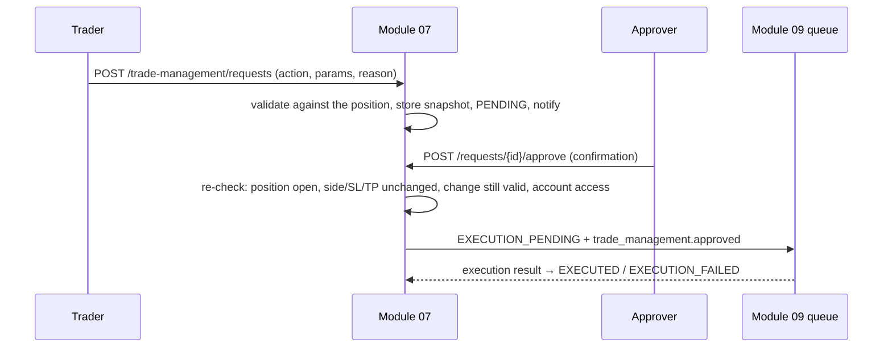

# Trade management guide

Trade management turns a person's wish to change an open position into an **approved execution request** for Module 09.
Module 07 changes nothing at the broker itself.

## Where positions come from
`GET /api/v1/trade-management/positions` reports its `source`:
- `module09`: positions reported by Module 09 (`position.updated` events or execution results). This is preferred once
  Module 09 exists.
- The account mirror: until then, the read-only MT5 mirror filled by `python -m aurum.cli sync-account` (run with
  `--loop` to keep it fresh). It is labelled in the UI, and `stale` becomes true after 5 minutes. Positions that
  disappear from the mirror are marked `CLOSED`.
- `none`: no source is configured. The list is empty and the reason is given. Positions are never invented.

## Actions
| Action | Parameters | Validation |
|---|---|---|
| `MOVE_STOP_LOSS` | `stopLoss` | Positive, not beyond the current price (`STOP_THROUGH_PRICE`). A wider stop is refused unless policy `management.allow_stop_widening` is on **and** `riskAssessmentId` points to a valid Module 06 PASS at the new stop |
| `MOVE_TAKE_PROFIT` | `takeProfit` | Positive and beyond the current price in the trade's direction |
| `BREAKEVEN` | none | The position must be in profit (`NOT_IN_PROFIT`). The stop moves to the entry price |
| `TRAILING_STOP` | `distance` (price units) | Needs a current price. The initial stop is `price ∓ distance`, checked like a stop move |
| `PARTIAL_CLOSE` | `volume` or `fraction` | Above 0 and below the open volume. `fraction` ≤ `max_partial_close_fraction` (0.99). Module 09 rounds down to the lot step |
| `CLOSE` | none | Whole position at market |
| `EMERGENCY_EXIT` | none | Whole position at market. Needs `management:emergency`, priority `emergency`, a 5-minute expiry and the typed phrase `CLOSE <SYMBOL>` |
| `CANCEL_PENDING_ORDER`, `MODIFY_PENDING_ORDER` | | **Not available** (`422 NOT_AVAILABLE`). No position source reports pending orders until Module 09 exists |

Each request needs a `reason` (at least 3 characters) and a `clientRequestId`. The service stores a **position
snapshot** and the **risk implications**: current stop, take-profit and price, whether the stop "reduces risk" or
"widens risk", and the remaining volume.

## Lifecycle

- **One active request per position.** A second one gets `409 REQUEST_ACTIVE`. An emergency exit cancels a pending
  ordinary request, but not one already with Module 09.
- **Approval re-check.** The approver sees the request against the *current* position. If its side, stop-loss or
  take-profit changed since the request, the approval is refused and a new request is needed.
- **Confirmation.**
  - Ordinary approvals send `confirmation.action` equal to the action shown.
  - An emergency exit needs the exact phrase from policy (default `CLOSE {symbol}`, for example `CLOSE EURUSD`).
  - Self-authorisation of an emergency exit is allowed by default
    (`management.emergency.allow_self_authorisation`). Turn it off to require a second person.
- **Expiry.** Pending requests expire after `management.expiry_minutes` (15), or 5 minutes for an emergency exit.

## Using the UI
Trade Management page → **Position management (human approval)** and **Change requests** (below the account positions table):
1. Choose **Request change** on a position, pick the action, enter the values and a reason, then submit.
2. The request appears in the list as Pending. A person with `management:decide` opens it, checks the comparison with
   the live position, ticks the confirmation (or types the emergency phrase), then approves or rejects.
3. The status then follows Module 09's reports. Until Module 09 exists, approved changes wait in the execution queue.
